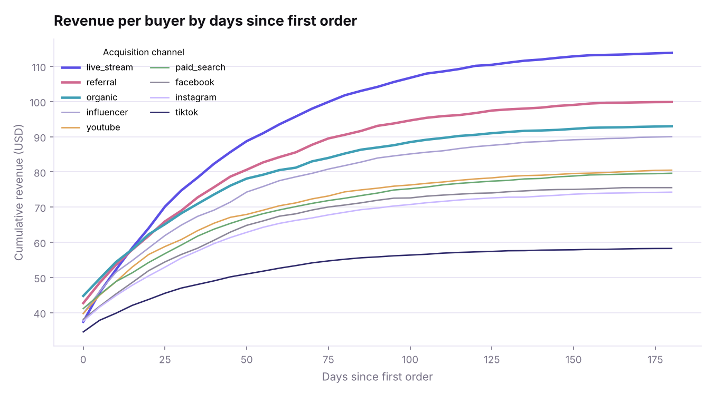
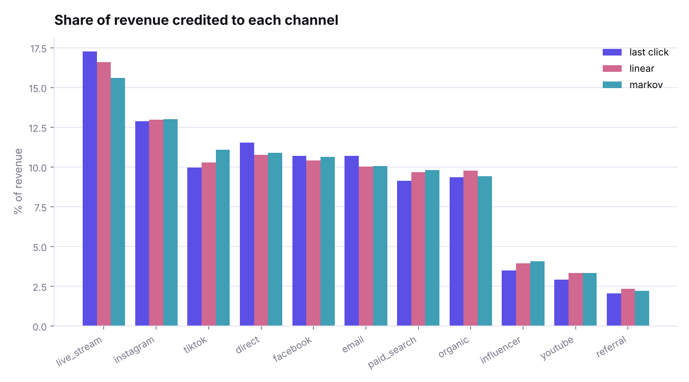
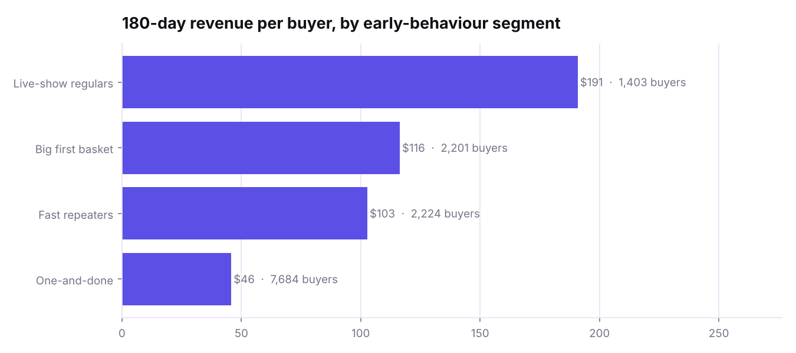
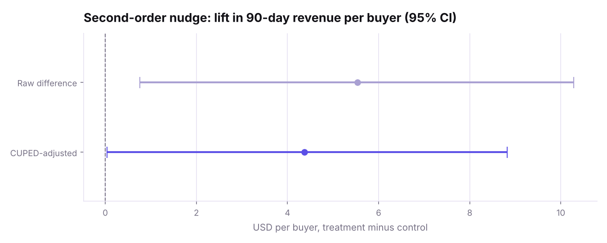

# social-commerce-ltv

How to find, and raise, the lifetime value of buyers who arrive from social channels.

This project takes a GA4-style event export from a social-commerce marketplace and answers three questions a growth team actually asks:

1. **Which channels bring buyers who are worth the most over time,** not just on the first order?
2. **Which channels deserve credit for revenue** once you stop trusting last click?
3. **What raises LTV,** and can we prove it with an experiment?

It runs on a laptop with DuckDB. No cloud account needed. The SQL is written in warehouse style, so it ports to BigQuery's GA4 export or to Snowflake with small dialect changes.

> All data is synthetic, generated by `scripts/generate_data.py`. The behaviours it plants come from my time running social analytics for a global marketplace (where new-buyer LTV from social channels rose 38%). No company data is used.

## Results

| | |
|---|---|
| Events in the raw export | 552,628 (1.5% duplicate deliveries removed) |
| Buyers with a full 180-day window | 13,512 |
| 180-day value, buyers with a 2nd order inside 30 days | **$161** |
| 180-day value, everyone else | $47 |
| LTV model error (MAE) vs channel average | **$29** vs $60 |
| Revenue held by the model's top 10% of buyers | **29%** (channel average: 15%) |
| Second-order nudge, 90-day revenue per buyer | **+$4.37 (+6.1%)**, 95% CI $0.06 to $8.80, p = 0.049 |
| Second-order nudge, buyers repeating within 30 days | 28.2% → **36.1%** |

### 1. Live-shopping buyers start small and end big



Live-stream buyers and TikTok buyers spend about the same on their first order ($36 vs $34). By day 180 the live-stream buyer is worth **$114** and the TikTok buyer **$58**. A first-order ROAS target would treat them as equals. A 180-day target would not.

| Acquisition channel | Buyers | First order | 180-day value | Repeat rate |
|---|---:|---:|---:|---:|
| live_stream | 1,203 | $36 | $114 | 59% |
| referral | 840 | $42 | $100 | 42% |
| organic | 1,359 | $44 | $93 | 38% |
| influencer | 1,510 | $39 | $90 | 42% |
| youtube | 1,250 | $39 | $80 | 37% |
| paid_search | 1,936 | $41 | $80 | 32% |
| facebook | 1,067 | $38 | $76 | 32% |
| instagram | 2,027 | $37 | $74 | 30% |
| tiktok | 2,320 | $34 | $58 | 23% |

### 2. Attribution: last click over-credits the closers



Six models run on the same 30-day touchpaths: last click, first click, linear, time decay (7-day half-life), position based (40/20/40) and a first-order **Markov chain** that uses non-converting journeys too. Every model's credit sums to the same total revenue, so they compare like for like.

Last click gives more to channels that close (direct, email, live stream) and less to the ones that open the journey (TikTok, influencers, YouTube). Full numbers are in [`report/attribution.csv`](report/attribution.csv).

### 3. Find the valuable buyers in week four, not month six



A gradient-boosted model trained on each buyer's **first 30 days** (order count, first basket, sessions, live-show visits, email visits, acquisition channel) predicts 180-day value with half the error of a channel average. It is tested on later cohorts than it was trained on, as it would run in production. The strongest single signal is a **second order inside 30 days**.

Clustering the same early behaviour gives four segments a CRM team can act on. "Live-show regulars" are worth about four times "One-and-done" buyers.

### 4. Raising LTV: a second-order nudge, tested properly



Since the second order is what separates high-value buyers, the experiment targets it. From June 2025, new social buyers were split 50/50. The treatment got a second-order coupon and a live-show invite.

- Repeat purchase inside 30 days rose from 28.2% to 36.1%.
- 90-day revenue per buyer rose by $4.37 (6.1%), even after the coupon's 10% discount on the nudged order.
- The readout uses **CUPED** with first-order value as the covariate. It is measured before the nudge, so it is safe to adjust on, and it narrows the confidence interval.

**What I would ship:** move social bidding from first-order ROAS to predicted 180-day value, put the nudge into the post-purchase journey for buyer types it helps, and route budget toward live shopping and creators, which last click undervalues.

## How it works

```
GA4-style events (parquet)
  └─ sql/01_stg_events      dedupe re-delivered events, normalise source casing
     sql/02_sessions        one row per session, mapped to a channel
     sql/03_users           acquisition channel, cohort, experiment arm
     sql/04_orders          orders numbered per buyer
     sql/05_touchpaths      sessions in the 30 days before each order
     sql/06_user_ltv        30/90/180-day value + first-30-day features
     sql/07_ltv_curves      cumulative revenue curves by channel
  └─ ltv/attribution.py     rule-based models + Markov removal effect
     ltv/model.py           180-day LTV model, time-based split, segments
     ltv/experiment.py      CUPED readout with bootstrap confidence intervals
     ltv/pipeline.py        runs it all, writes report/
```

The generated export plants problems real GA4 exports have: duplicate event deliveries, sources in mixed case, and users who arrive on one channel and return on several others.

## Run it

```bash
pip install -r requirements.txt
```

```bash
make data report
```

```bash
make test
```

`make data` writes about 550k events to `data/raw/events.parquet` in a few seconds. `make report` rebuilds every chart and table in `report/`. CI runs the tests and the full pipeline on every push.

## Tests

18 tests cover the parts that are easy to get quietly wrong:

- Every attribution model's credit sums to the revenue it attributes, and position-based and time-decay weights follow their rules.
- Markov credit goes to the channel every converting path depends on.
- CUPED keeps the mean and cuts variance, and the readout recovers a planted lift.
- The SQL removes duplicates and normalises casing, every order has a touchpath, and 30/90/180-day values never decrease.
- The generator is deterministic for a given seed.

---

Built by [Artur Kochetkov](https://arturkochetkov.dev) · [LinkedIn](https://www.linkedin.com/in/artur-kochetkov/)
